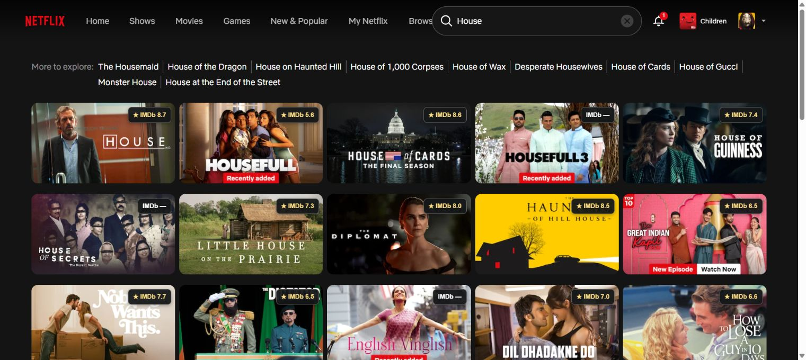
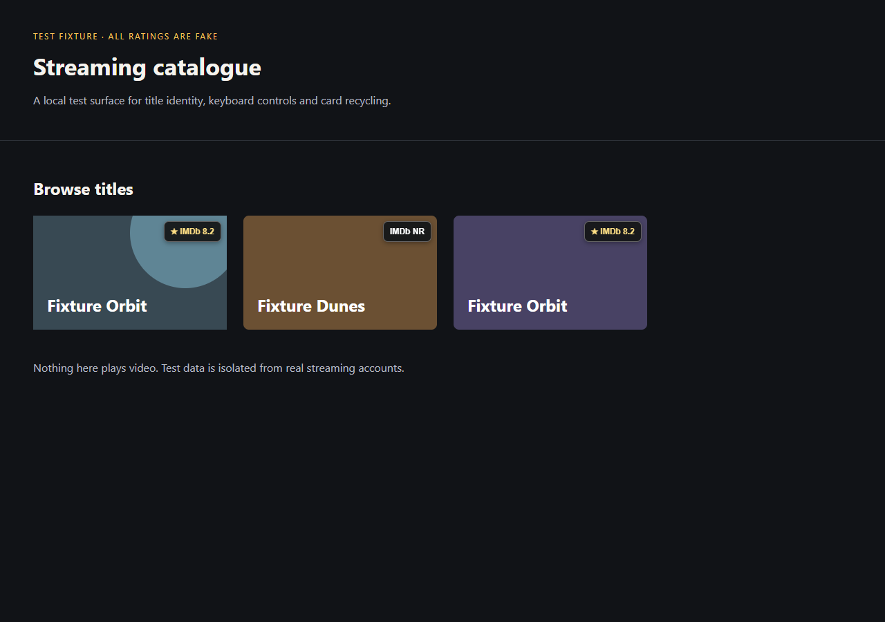

# Automatic visible title ratings

Version 0.2.0, 5 November 2026. Historical design: version 0.3 now adds cookie-free public Netflix movie metadata when the direct ID link is missing. See README and verification for current behavior.

Stream Companion now attempts to identify every visible supported Netflix card automatically. Users connect their OMDb key once and browse normally. Opening each movie or series is no longer the normal way to obtain identity evidence.

## User experience

1. A newly visible card briefly shows `IMDb …`.
2. Its Netflix ID is checked against a cached or batched public ID mapping.
3. A unique mapped IMDb work is validated with OMDb and receives its rating.
4. Duplicate cards and later visits reuse the saved identity and weekly/monthly score cache.

The adapter covers both inspected `standard-card` and Continue Watching `progress-card` links. Badges remain separate from Netflix playback links and are hidden on clipped or obscured cards.

| State | Meaning |
|---|---|
| `★ IMDb 8.2` | A real score for the identified work; the number here is illustrative |
| `IMDb …` | Automatic lookup is in progress |
| `IMDb NR` | The work was identified but OMDb returned no usable score |
| `IMDb —` | A unique identity could not be established automatically |
| `IMDb !` | A temporary provider, connection or request-allowance problem |

Unavailable states explain the reason in details. Find a match and Wrong match remain optional controls. A streaming catalogue may include titles without a usable provider score or an unambiguous external identity; the extension does not invent a number for those exceptions.

## Identification order

1. Preserve the user's correction or a compatible accepted mapping.
2. For a new source title, query Wikidata's direct Netflix-ID to IMDb-ID relationship.
3. Accept only one distinct IMDb title identifier across the complete returned binding set.
4. Fetch/validate OMDb details by that identifier. Reject episodes and explicit observed year/type contradictions.
5. If direct mapping is unavailable but actual release-year/type evidence exists, retain the strict title-search resolver.
6. Otherwise show an honest unavailable state; never pick a remake by popularity or score.

Wikidata defines [Netflix ID P1874](https://www.wikidata.org/wiki/Property:P1874) and [IMDb ID P345](https://www.wikidata.org/wiki/Property:P345). Both identifiers on the same entity provide the link. This is community-maintained data, so the result is validated and its provenance is retained.

A direct-ID match may legitimately use a translated display title. Label equality is not required when a validated Netflix identifier establishes identity. Explicit contradictions still block display. Saved manual choices and rejected candidates take precedence over automatic results.

Accepted automatic mappings record Wikidata entity IDs and retrieval time. They revalidate after 30 days of source age during normal visible demand. Compatible fresh rating data can be reused when the identity remains unchanged; a changed automatic identity is validated before updating. A transient mapping-service outage can retain a previously supported cached identity. Explicit Refresh remains a budgeted rating refresh and does not silently rematch a title.

## Requests and privacy

Visible requests coalesce for 50 ms into batches of up to 20 Netflix IDs. The mapping provider uses one request at a time, a one-second minimum start gap, durable lease/cooldown state, a 12-second timeout and a bounded response size. It respects a valid Retry-After hint and uses a descriptive browser client header. See the [query service manual](https://www.mediawiki.org/wiki/Wikidata_Query_Service/User_Manual#Query_limits) and [browser client header guidance](https://foundation.wikimedia.org/wiki/Policy:Wikimedia_Foundation_User-Agent_Policy#JavaScript).

Positive source results are cached for 30 days; genuine missing/conflicting mappings for one day. Timeouts, malformed data and throttling never become cached missing mappings. Requests whose visible demand disappears are cancelled before dispatch where possible. These source requests do not consume the OMDb allowance.

Only the public Netflix title IDs are sent to `https://query.wikidata.org/sparql`. The new manifest permission is restricted to `https://query.wikidata.org/*`; the worker constructs the fixed endpoint and query. Wikidata never receives the OMDb key or streaming credentials. Rating requests still go only to OMDb with the existing local accounting and circuits.

Scores remain fresh for seven days for current-year films and ongoing/unknown-end series, and 30 days for older films and explicitly completed older series. User corrections, the API key, usage accounting and existing score caches are preserved by the update. No data migration or new user account is required.

## Feasibility evidence

Two public batch queries used 61 unique Netflix IDs observed in the user's catalogue. The first 11 established titles all returned one direct IMDb candidate. A further 50-title sample returned 44 direct candidates. Together this is **55 of 61 IDs with a direct candidate**, not a measured numeric-rating coverage or correctness guarantee.

The six IDs absent from that source snapshot were `83127937`, `81970498`, `81956629`, `70136130`, `80031533` and `82068293`. The result set included recent and Indian-language titles as well as established English films/series. No personal key was used for these public mapping queries.

## Updating the installed copy

The installed 0.2 update was live-tested after reload: all five first-row browse cards and all five Continue Watching cards loaded numeric ratings without opening title details. Search for House showed 12 numeric ratings among 15 visible cards. House's fetched timestamp remained unchanged after a full reload, with a 30-day refresh policy. These samples demonstrate the usability improvement; they are not a catalogue-wide guarantee.

The updated unpacked files are in the same `dist` directory. Reload Stream Companion once at `chrome://extensions`, allow the newly declared Wikidata host access if Chrome requests it, then reload Netflix. The browser-control tool explicitly blocks Chrome extension management pages, so that reload is the one manual step. The existing saved key and cache remain in the same extension profile.

The ZIP is `releases/stream-companion-0.2.0.zip`. Tests use the actual MV3 extension with isolated synthetic Netflix, OMDb and Wikidata responses; provider hosts also resolve to loopback in the fixture context to prevent external test traffic.

