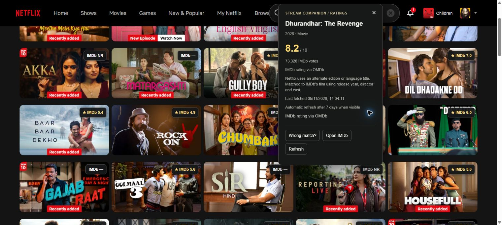

# Catalogue coverage audit

5 November 2026. Baseline installed extension: 0.3.0. Account-specific Netflix search results; first 15 cards for each of 12 deliberately varied keywords. This is a coverage sample, not statistical random sampling, a catalogue-wide guarantee, or a precision benchmark. Duplicate Netflix IDs are counted once in the unique-title total. No title playback was started; account settings, keys and user corrections were preserved. The extension populated its automatic mappings and caches normally.

## Baseline results

180 card observations represented 135 unique Netflix titles: 112 numeric ratings, 6 identified titles with no usable OMDb score (NR), 17 unresolved identities. No pending or deferred states remained in the final recorded sample. Two temporary busy states resolved on revisit and were not counted as identity failures.

| Keyword | Numeric /15 | NR /15 | Unresolved /15 |
|---|---:|---:|---:|
| english | 14 | 0 | 1 |
| space | 14 | 1 | 0 |
| hindi | 10 | 2 | 3 |
| crime | 11 | 1 | 3 |
| time | 12 | 1 | 2 |
| animation | 14 | 0 | 1 |
| thriller | 13 | 2 | 0 |
| Aamir Khan | 12 | 0 | 3 |
| Tom Hanks | 15 | 0 | 0 |
| Shah Rukh Khan | 15 | 0 | 0 |
| love | 11 | 1 | 3 |
| comedy | 10 | 2 | 3 |

The English-language search returned 14 numeric scores; Hindi returned 10. Both Tom Hanks and Shah Rukh Khan actor samples returned 15 numeric scores. These results do not support treating Hindi text as the failing component. Missing direct-ID data, Netflix naming variants, series/season evidence and ambiguous candidate sets are separate limitations.

## Where resolution stopped

| Group | Unique titles | Evidence and next step |
|---|---:|---|
| Edition or language labels |4| Salaar (English), Dhurandhar The Revenge (Raw & Undekha), Thugs of Hindostaan (Telugu), Thugs of Hindostan (Tamil). Public film years and credits exist; test controlled alias matching with independent director/cast corroboration. Canonical spelling/subtitle differences may still remain. |
| Series with no direct ID and unsafe start-year evidence |7| Public TVSeries pages may show latest-season years. The movie fallback intentionally does not label these as series start dates. A verified series identity/start year is still needed. |
| Ambiguous provider results |2| David and Love. The extension did not pick the highest-rated or first result. |
| Other unresolved movies |4| Dhoom:3, Desprotexida: El crimen de Pazos (public English title Unprotected: Murder in Galicia), The One About Matthew Perry, Sumukhi Suresh Hoemonal. Public film metadata exists, but the automatic exact lookup did not establish identity. Punctuation, alternative names, catalogue differences or provider data need separate checks; this is not proof the films lack IMDb pages. |

The 6 NR titles are already identified and are not identity-matching failures. Neither popularity nor acclaim supplies missing matching evidence.

## Dhurandhar investigation and 0.3.1 changes

The visible missing card is [Dhurandhar The Revenge (Raw & Undekha)](https://www.netflix.com/title/82813021), a 2026 Netflix Movie. IMDb lists the underlying film as [Dhurandhar: The Revenge](https://www.imdb.com/title/tt39139925/). The Netflix edition qualifier and separator difference defeat literal title matching. Netflix also has a separate [Dhurandhar](https://www.netflix.com/title/82156122) Movie from 2025; its identity must stay distinct. No production film IDs are hardcoded by the fix.

Version 0.3.1 keeps exact matching first. After a complete exact search fails, it can remove only an allowlisted trailing edition/language label, compare punctuation as separators, and require an exact movie year plus a matching director and at least two distinct matching cast names. Sequel words/numerals and meaningful subtitles remain significant. The entire candidate set must be available and unique. A cached rating without credits cannot prove this match and gets a bounded detail lookup. Netflix public JSON-LD uses plural actors/directors fields; both observed and standard schema spellings are supported, while conflicting credits fail closed. Details disclose that the rating belongs to IMDb's underlying film. Existing corrections, rejections, budgets, source/score caches and revision/reset protections remain.

New alias matching passed 395 unit tests and 11 MV3 browser tests. Installed 0.3.1 live verification passed, as recorded below. It does not claim to resolve every alias, untranslated title, series or provider gap.

## Live repeat after installing 0.3.1

All 12 searches were repeated using the same Shubham profile. The 180 card observations contained exactly the same 135 unique Netflix IDs as the baseline. Numeric ratings rose from 112 to 115; NR remained 6; unresolved fell from 17 to 14. There were no final pending/deferred states. This demonstrates a measured coverage improvement, not catalogue-wide identity precision.

| Keyword | Numeric before /15 | Numeric after /15 | NR after /15 | Unresolved after /15 |
|---|---:|---:|---:|---:|
| english | 14 | 15 | 0 | 0 |
| space | 14 | 14 | 1 | 0 |
| hindi | 10 | 11 | 2 | 2 |
| crime | 11 | 11 | 1 | 3 |
| time | 12 | 12 | 1 | 2 |
| animation | 14 | 14 | 0 | 1 |
| thriller | 13 | 13 | 2 | 0 |
| Aamir Khan | 12 | 13 | 0 | 2 |
| Tom Hanks | 15 | 15 | 0 | 0 |
| Shah Rukh Khan | 15 | 15 | 0 | 0 |
| love | 11 | 11 | 1 | 3 |
| comedy | 10 | 10 | 2 | 3 |

Three previous misses became numeric: Dhurandhar The Revenge (Raw & Undekha) 8.2, Salaar (English) 6.7, and Thugs of Hindostan (Tamil) 4.1. The Dhurandhar badge details identified IMDb tt39139925, canonical film Dhurandhar: The Revenge, Movie 2026, and disclosed the release-year/director/cast match. It retained its 14:04:11 fetched time after navigation back to freshly loaded Hindi results, with seven-day freshness. The Netflix URL remained on Search and no Netflix title detail modal appeared.

The remaining 14 identities are explicitly listed in the comparison JSON: 7 series still lack safe start-year/ID evidence; David and Love remain ambiguous; Thugs of Hindostaan (Telugu) retains an unresolved spelling/language variant; Dhoom:3, Unprotected: Murder in Galicia (shown as Desprotexida), The One About Matthew Perry, and Sumukhi Suresh Hoemonal remain film lookup gaps. No claim is made that these lack IMDb ratings. Dhoom's punctuation-style title is still unresolved in the live provider lookup even though the comparison helper can compare separators after a candidate is retrieved. This update does not make fuzzy spelling matches or assume all alternate titles identify the same film.

## Evidence files

- [Per-query baseline observations](catalogue-audit-0.3.json)
- [Per-query live repeat](catalogue-audit-0.3.1.json)
- [Same-cohort comparison and all remaining titles](catalogue-audit-comparison.json)
- [Dhurandhar live panel readback](dhurandhar-live-verification.json)
- [Public-source diagnostics for all 17 unresolved identities](catalogue-audit-diagnostics-0.3.json)
- [Verification and test details](verification.md)

## Earlier Hindi-film repair, verified live in 0.3.0

English Vinglish 2012 matched IMDb tt2181931 with OMDb 7.8; Gully Boy 2019 matched tt2395469 with 7.9; Baar Baar Dekho 2016 matched tt5197544 with 5.4. Rock On 2 (4.9) and Golmaal 3 (5.6) also populated. In the initial 20-card Hindi cohort, numeric scores increased from 7 to 12; NR states from 2 to 3; unresolved states fell from 11 to 5. These observations precede the broader audit and are a separate sample. English Vinglish retained its 13:27:29 fetched timestamp after page reload, with 30-day freshness; its expanded hover also showed 7.8. No new Stream Companion warnings were captured during these checks.

