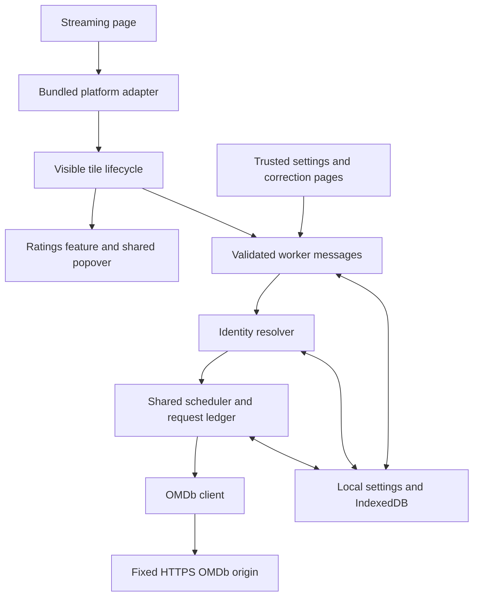

# Stream Companion v1 product and technical design

**Working product name:** Stream Companion

**Package:** `stream-companion`

**Design date:** 5 November 2026

**First extension version:** 0.1.0

**Initial capability:** IMDb ratings on Netflix in desktop Chrome.

**Implementation update:** version 0.2 adds automatic ID matching and Continue Watching coverage. [Automatic visible title ratings](Automatic_Ratings_v0_2.md) supersedes the initial matching interaction and network-permission baseline below; weekly/monthly score caching remains in place.

Stream Companion adds useful context while browsing streaming services. Ratings are its first feature; Netflix is its first platform adapter. Product naming, shared identities and UI ownership allow later features and platforms without making them dependencies of the first release. The working name has not been cleared for public distribution.

The governing rule remains: **display a numeric rating only after the title identity has sufficient support.** Uncertain identity produces a matching action. Missing or failed data never produces a sample score.

## Product scope

| Dimension | V1 | Extension path |
|---|---|---|
| Product | Stream Companion | Keep the product independent of any streaming service or rating source |
| Feature | Ratings | Add packaged feature modules when a concrete use case is chosen |
| Platform | Netflix modern browse cards | Add a separately verified adapter and exact host access for each later platform |
| Rating source | IMDb | Preserve each future source's own attribution and scale |
| Data provider | OMDb with a personal key | Add a provider boundary with its own credentials, quota and terms |
| Runtime | Manifest V3 Chrome extension | Evaluate other browsers separately |
| Data | Local settings, corrections, caches and request accounting | Sync or backend only if a later requirement justifies them |

No other platform is advertised as supported in v1. Prime Video, Disney+ or other services require independent identity, DOM, permission and playback checks. Watchlist, filters, recommendations and episode support are potential product directions rather than implemented controls or committed milestones.

The first version excludes playback interaction, account/profile management, private streaming APIs, cookies, DRM, background catalogue scraping and an LLM dependency.

## Naming and module boundaries

| Concept | Name | Example |
|---|---|---|
| Product | Stream Companion | Toolbar and settings branding |
| Platform | `platformId` | `netflix` |
| Platform title | `PlatformTitleRef` | `{ platformId: 'netflix', titleId: '70136129' }` |
| External identity | `ExternalTitleRef` | `{ namespace: 'imdb', id: 'tt0758790' }` |
| Rating source | `source` | `imdb` |
| Transport/provider | `provider` | `omdb` |
| Feature | Packaged module | `features/ratings` |
| Adapter | `StreamingPlatformAdapter` | `platforms/netflix` |

A Netflix title ID is not a global title ID. Mappings use a structured tuple of platform and title ID. The same numeric ID on a future platform represents a separate source identity. Never derive permanent identity from title text.

Two independently confirmed source mappings may reference one IMDb work and reuse its cached rating. A correction on one platform does not establish a mapping on another platform. Editions, remakes, episodes and alternate cuts are not merged by name.

Use ordinary static TypeScript modules and a bundled adapter registry. A runtime plugin loader, feature marketplace, generic event bus, central world catalogue and shared backend are unnecessary for v1.

## User experience

The visual system uses charcoal surfaces, warm amber actions and readable system typography. Settings use section dividers and a narrow navigation column; correction uses a candidate list and a preview. The browse UI remains a compact dark IMDb pill.

### Setup

1. Installation opens Settings.
2. The user obtains and activates their own key from [OMDb](https://www.omdbapi.com/apikey.aspx).
3. A masked input accepts the key. Save and test stores it locally and sends one budgeted reference lookup.
4. The user reloads existing Netflix browse tabs after installation or extension updates.

The key is never requested in chat, embedded in source, returned to the content script or shown in diagnostics. A configured key is distinct from an authentication test result; only a successful request verifies that it was accepted at that time.

### Badge and details

| Label | Meaning |
|---|---|
| `★ IMDb 8.2` | Confirmed identity with a usable score; example only |
| `★ IMDb 8.2 ·` | A stale cached score within the allowed display window |
| `IMDb …` | A lookup is in progress |
| `IMDb ?` | Matching is required; details explain why |
| `IMDb · Setup` | No configured provider key; open Settings |
| `IMDb NR` | Confirmed work with no usable score returned by OMDb |
| `IMDb !` | Lookup deferred or unavailable; details give the reason |
| No badge | Disabled, hidden, clipped, obscured or unsupported surface |

A badge opens one shared labelled nonmodal dialog with the title, year, type, score, votes, attribution and fetched time. Controls allow choosing a match, opening IMDb, refreshing a known rating or opening Settings. Escape dismisses it and restores focus where possible. Controls have visible keyboard focus; the panel stays within the viewport. Normal badge updates are not live-announced.

Controls mount in one top-level Shadow DOM overlay, outside Netflix links and buttons. Position comes from visible card rectangles. Clipping and occlusion checks suppress controls over carousels, dialogs or unrelated page content. Shadow DOM provides style isolation; it is not an authorization boundary. Event cancellation supplements the separate mount structure.

### Correction

1. Choose match or Wrong match opens a packaged page with a short-lived random context ID.
2. Search the provider or enter an IMDb title ID/HTTPS URL.
3. Preview the fetched title, corresponding year, movie/series type and score.
4. Explicitly confirm the selection.
5. The worker commits a revision and invalidates all registered visible copies of that source title.

The worker binds the preview to its context, age, mapping revision and reset epoch. An episode cannot satisfy a movie/series preview. Explicit contradictory year/type evidence requires selecting a compatible work.

### Popup and settings

The toolbar popup reports enabled state, provider status, the local request estimate and a live active-tab handshake. Failed connection can mean an old content script, a closed connection or an unsupported page; it does not establish that a tab is Netflix.

Settings offer badge position, enabled state, cache-only mode, saved matches and separate cache/key/match actions. Clearing ratings preserves corrections, credentials, request accounting and provider circuits. Removing a saved match leaves a revision tombstone; resetting matches advances a global epoch so pre-reset jobs cannot recreate old choices.

Cache-only blocks provider work in browsing and correction. An explicitly requested key connection test is the disclosed exception and uses one accounted request.

## Architecture



Content owns page lifecycle and rendering. The worker owns authorization, credentials, network activity and shared data mutations. Netflix selectors and URL parsing remain under `platforms/netflix`; rating presentation does not parse platform markup. Provider requests and response normalization remain in the provider layer. V1's scheduler transport is specifically OMDb; introducing a second provider will require a provider-specific scheduler/accounting namespace rather than treating quotas as shared.

The code is TypeScript, vanilla DOM and esbuild, with no production package dependencies. Content bundles as a classic script and the service worker as an ES module. All executable code ships locally.

## Shared data contracts

```ts
interface PlatformTitleRef { platformId: string; titleId: string }
interface ExternalTitleRef { namespace: 'imdb'; id: string }
interface TitleObservation {
  ref: PlatformTitleRef;
  displayTitle: string;
  mediaType: 'movie' | 'series' | 'unknown';
  year?: { value: number; meaning:
    'movie_release' | 'series_start' | 'season_release' | 'unknown' };
  aliases?: string[];
  adapterVersion: number;
}
interface RatingRecord {
  subject: ExternalTitleRef;
  source: 'imdb'; provider: 'omdb';
  title: string; year: string; mediaType: 'movie' | 'series';
  score: number | null; scale: 10; votes: number | null;
  fetchedAt: number;
}
```

The source namespace and provider are deliberately separate even though their v1 values are fixed. Add supported discriminated variants with a real second implementation. Keep rating scales and vote semantics source-specific; do not create a normalized composite score implicitly.

Storage schema, message protocol, adapter and resolver each have separate versions. Semantic fingerprints include normalized identity evidence and adapter version; timestamps and display-only activity do not generate new identity jobs.

## Netflix adapter

The modern interface inspected on 5 November 2026 uses `a[data-uia="standard-card"][aria-label]` links with a `jbv` query title ID. Hashed style classes are excluded from selectors. `/watch/` IDs never establish whole-series identity.

V1 attaches on `/browse`, `/browse/genre/<id>`, `/browse/my-list` and `/search` when those verified card hooks exist. Browse markup was inspected in the logged-in account. Search and My List remain live acceptance checks; equivalent markup is handled only when present. Other layouts fail closed.

The user-opened detail modal exposes scoped metadata. A movie may supply a title image label, explicit movie label, runtime and release year. The adapter requires their association with the current `jbv` title. A series panel exposed a later season date; the adapter does not call that a start year. Non-English metadata labels may prevent enrichment and leave manual matching necessary.

Lifecycle uses mutation debouncing, visibility stability and an intersection observer. Extension DOM changes are ignored. Scrolling repositions overlays. Recycled cards lose prior numeric state immediately. Results require matching document epoch, element generation, semantic fingerprint and a nonobsolete mapping revision. Hidden documents and unsupported navigation remove overlays and release queued demand. In-flight fetches may finish and populate a safe ID cache.

## Identity resolution

Resolution order is saved explicit mapping, compatible accepted automatic mapping, strict new resolution, then manual choice. New automatic acceptance requires title/verified alias plus explicit corresponding year and media type, with one supported candidate in a complete inspected search result set. Title-only, popularity, vote count and rating value cannot establish identity.

Normalization preserves Unicode, sequel numerals and subtitles. Punctuation and whitespace equivalence are conservative. Translated label changes alone do not override saved source identity. A series score remains the whole-series score; episode averaging is outside scope.

The provider search result does not contain authoritative rating details. Fetch the prospective selected IMDb ID and validate its returned identity before acceptance. A truncated set or ambiguity leads to manual choice. Baseline automatic work uses one search and one detail call, with at most three charged logical attempts per evidence/revision/reset window. Interrupted attempts remain conservatively counted. Genuine misses are cached separately from transient provider failures; new evidence, revisions or reset epochs reopen matching.

Every accepted mapping mutation increments its revision in a transaction. Automatic writes compare their captured revision and reset epoch. Removing a match preserves rejected candidates; explicit selection may reinstate a chosen candidate. An old job can cache a valid IMDb response but cannot overwrite a later mapping.

## Provider scheduling and storage

| Policy | V1 default |
|---|---|
| Concurrent provider requests | At most two across all tabs, including persisted unexpired leases |
| Start spacing | At least 500 ms |
| Queue | At most 100 jobs, explicit actions prioritized |
| Rolling local allowance | 900 attempts per credential over 24 hours |
| Automatic stop | 800 attempts; reserve the remainder for explicit actions |
| HTTP timeout | Eight seconds |
| Worker-loss lease | Twenty seconds |
| Fresh recent/active score | Seven days for current-year films and ongoing/unknown-end series |
| Fresh older/completed score | 30 days for earlier-year movies and series with an explicit earlier end year |
| Stale numeric display | Seven days after the applicable freshness window, with fetched-time indication |
| Missing provider score | Same weekly/monthly schedule as a scored record |
| Search miss | Six hours for the exact evidence/revision/reset window |
| Ambiguity | 24 hours; new evidence reopens it |
| Correction context / preview | 30 minutes / 10 minutes |

These are application defaults rather than provider guarantees. OMDb advertises a 1,000 daily free allowance; local accounting cannot measure external uses or the provider reset boundary. Label the count as requests recorded by this extension. [OMDb key registration](https://www.omdbapi.com/apikey.aspx)

Freshness uses the work's year/type and fetched timestamp. Year-based age is approximate: current-year movies refresh weekly; an earlier-year movie refreshes monthly. Only a closed series year range establishes an end year for monthly refresh. An old series start year alone does not imply completion, so ongoing or unknown-end series stay weekly. Fresh cached IMDb details may be reused in correction previews and candidate validation. Explicit Refresh and key testing bypass freshness while retaining request accounting and circuits. No storage migration is required when this policy changes.

Before dispatch, a strict-durability IndexedDB transaction checks the circuit, credential namespace, allowance, dispatch time and active leases, then reserves one attempt. Fetch happens after commit, outside the transaction. Abort, timeout and worker loss retain the charge. Re-entering the same key reuses its stable local credential namespace. Clock rollback pauses allowance expiry; implausible live clock jumps pause requests until restart/correction.

Deduplicate normal requests and combine live demand across callers. Recheck settings and visibility demand before dispatch. Explicit consumers promote a shared job's priority. A document can release a title or all demand; demand also expires after 30 seconds to bound missed lifecycle notifications. No closed-tab backlog is replayed after a worker restart. V1 uses renewed demand and bounded reconnects rather than autonomous alarms or guaranteed HTTP delivery.

Invalid keys block requests until replacement or explicit retest. Quota responses use one-hour initial cooldown and a single shared demand-driven probe, with subsequent two/four/eight/up-to-24-hour backoff. Temporary failures back off; three consecutive failures extend the transient circuit. Cached reads do not clear circuits. A success from an older already-running request cannot clear a newer key or quota circuit.

Settings and raw key live in trusted-only `chrome.storage.local`; sender-derived routing metadata lives in trusted-only session storage. IndexedDB stores mappings, ratings, resolution attempts, contexts, provider state, leases and request attempts. Clearing one data class does not silently reset another. Expendable caches are bounded; user corrections and unexpired usage remain protected.

The first implementation returns a terminal/cache/deferred response for each request. It does not expose durable multi-stage job IDs or a GET_JOB_STATUS protocol. Recovery reissues live demand with persisted accounting and guards. Round-robin tab fairness, richer evidence provenance and direct external-ID enrichment are possible later refinements; no FIFO fairness claim is made beyond explicit-action priority.

## Security and privacy

Content scripts inspect the DOM and exchange messages with the worker. Provider fetches stay in the extension origin under an exact OMDb host permission. [Chrome content scripts](https://developer.chrome.com/docs/extensions/develop/concepts/content-scripts), [cross-origin requests](https://developer.chrome.com/docs/extensions/develop/concepts/network-requests)

The manifest asks only for `storage`, the Netflix content-script match and OMDb HTTPS host access. It does not request broad all-site access, history, cookies, `tabs`, `webRequest`, scripting, alarms or unlimited storage. Incognito is disabled. Later adapters add exact host matches only after their scope is selected.

The broker validates sender ID, packaged page identity or top-frame Netflix origin, command authority, message size, exact fields and bounded primitive values. A claimed platform cannot override the verified origin. Content has no key/mapping-management capability or arbitrary network URL relay. Provider and user strings render through DOM text APIs.

Restrict storage access before loading or writing credentials. This protects against direct content-script storage reads; it does not turn an installed extension into a secret vault. [Chrome storage](https://developer.chrome.com/docs/extensions/reference/api/storage)

OMDb receives the lookup title/year/type or IMDb ID, API key and normal connection metadata. Settings and mappings stay in this browser profile. No analytics, profile identity, viewing-history stream, raw DOM, session export, or private Netflix endpoint is used. Diagnostics contain explicit aggregate fields rather than raw titles, URLs, credential fingerprints or provider responses.

The personal package includes source attribution. Public distribution requires a name check, actual permission/data disclosure and a review of applicable display/caching rights. OMDb's licence notice describes CC BY-NC 4.0 and nonaffiliation with IMDb. [OMDb licence notice](https://www.omdbapi.com/apikey.aspx)

## Extension milestones

| Milestone | Required evidence |
|---|---|
| V1 local candidate | Builds, deterministic tests, actual MV3 fixture workflow, explicit live limitations |
| V1 live acceptance | Personal key smoke test; browse/search/My List, keyboard and playback separation in the real account |
| V1 coverage acceptance | Labelled 100-title corpus including Hindi/English, remakes, aliases, series, sequels and unavailable scores; report raw accuracy/coverage separately |
| Next platform | Isolated adapter, verified source IDs/safe placement, precise host access, same regression suite |
| Next feature | A chosen use case, explicit capabilities/data needs, its own controls and teardown without coupling to ratings |
| Public release | Name, provider rights, disclosures, full UX acceptance and distribution packaging |

Do not trade identity accuracy for badge coverage. Automatic coverage is limited when browse cards expose only names. Use corrections or improve validated evidence sources before relaxing matching rules.

## Verification and acceptance

Deterministic checks cover Unicode/sequels, year meanings, candidate truncation, hostile messages, malformed provider data, missing scores, atomic allowance, worker recovery accounting, settings and demand changes, correction/reset races and cache boundaries. Browser fixtures load the actual unpacked MV3 extension with isolated fake provider data; fixtures cannot establish real-site playback compatibility or live provider response accuracy.

Release acceptance requires one correct status/rating per supported tile, no stale identity bleed, corrections surviving restart, no key in DOM/messages/diagnostics, durable reservations before every call, truthful failures, reversible settings and no interference with streaming controls. Performance targets from the original proposal remain targets until measured, including cached p95 under 250 ms, no extension-caused long task over 50 ms and no retained disconnected card growth.

See `verification.md` for measured checks and remaining live acceptance work. See `README.md` for exact build, installation and test commands.

## Version 0.3 coverage update

Direct ID matching remains first. A missing direct film relationship can now fall back to public Netflix movie metadata: canonical name, visibly displayed release year and explicit Movie type, bound to the same Netflix title ID. The worker requests a fixed public country catalogue route without cookies, authentication or the OMDb key, caches the extracted evidence for 30 days, and reuses the strict complete OMDb title/year/type search and detail validation. This is language independent and requires no per-title hardcoded mapping. Date-created/catalogue-added dates, series latest-season years, popularity and scores are never matching evidence. Existing corrections, rejected matches, revision/reset protections, scheduler limits and seven/30-day rating freshness remain in force. A new resolver version expires older negative matching decisions without clearing user data.
