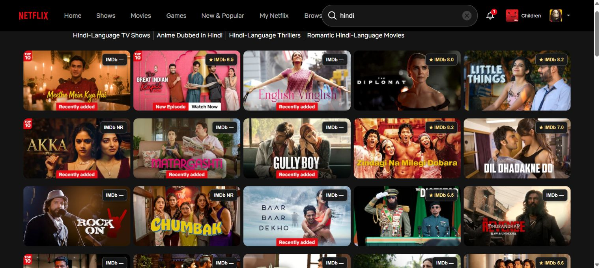
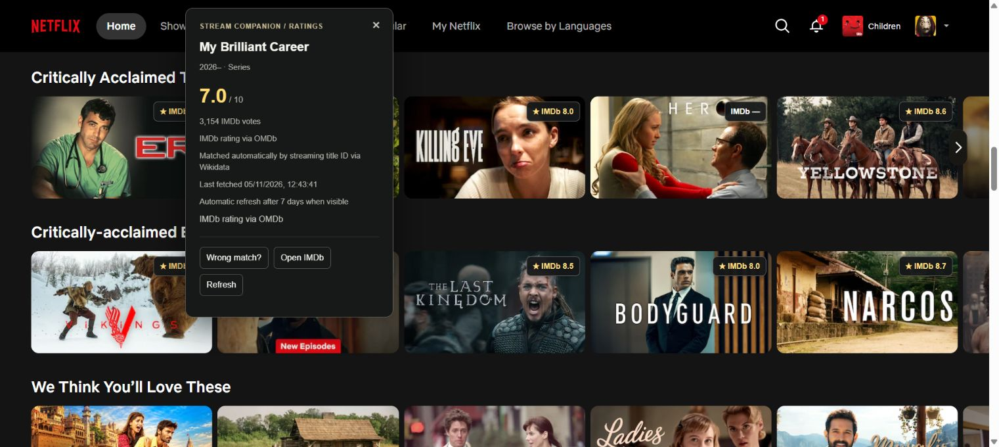
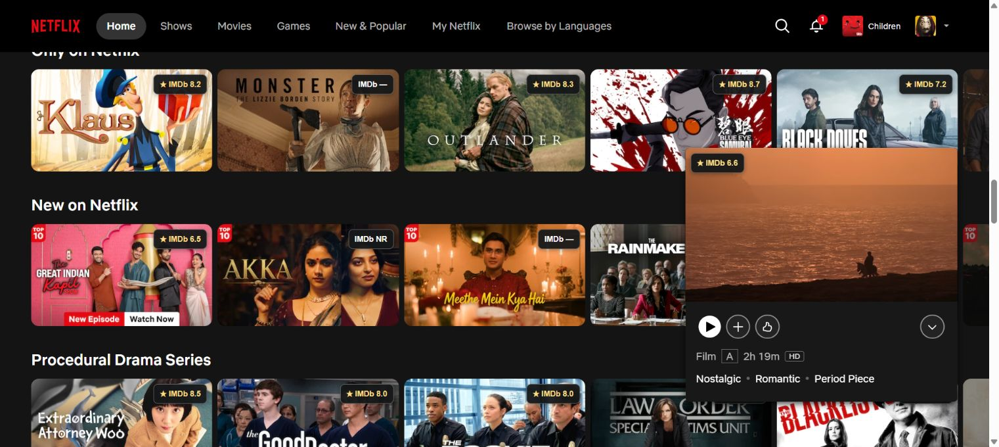
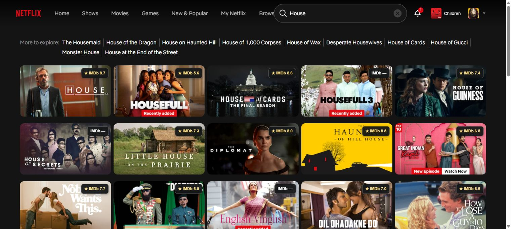
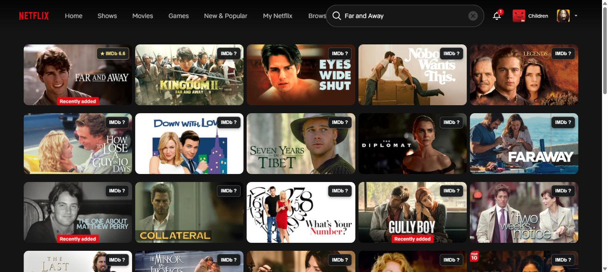
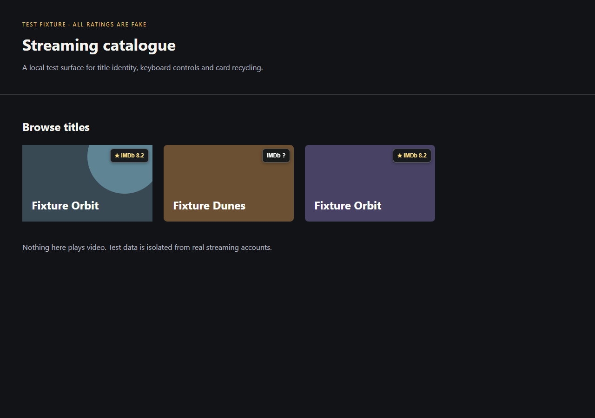
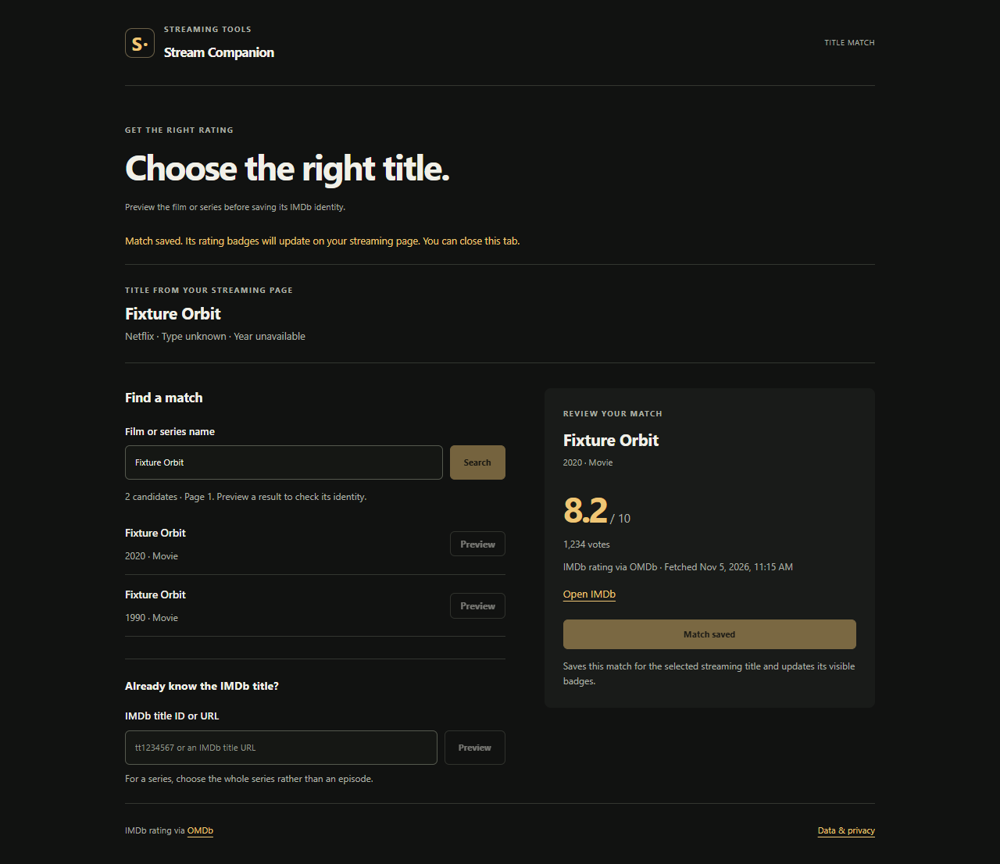
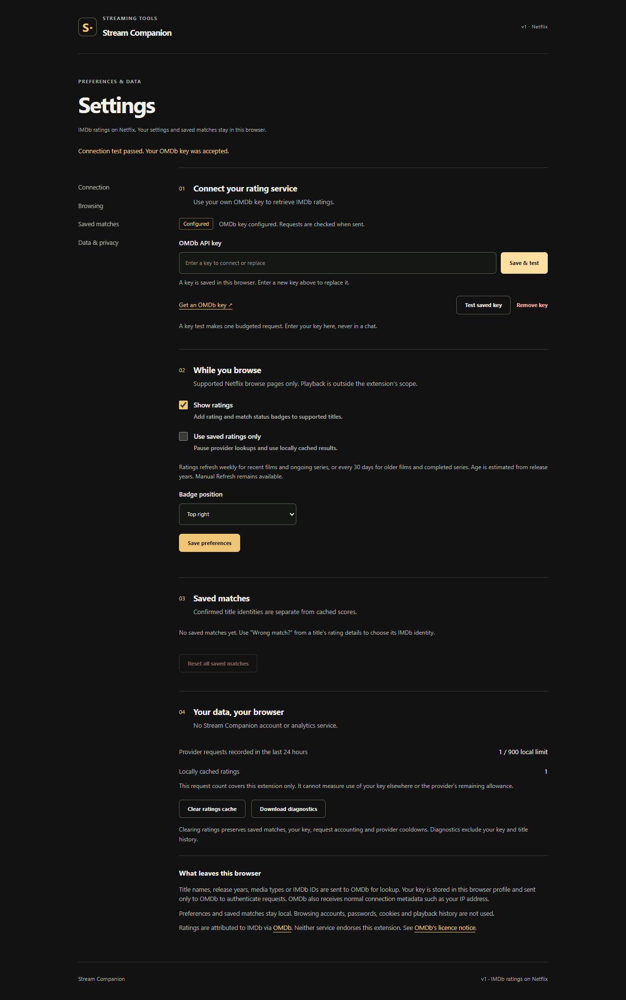

# Stream Companion v1 verification

## JioHotstar and primary feature switches (0.6.0)

Typecheck, build, 564 unit tests and all 31 browser tests passed. Three new disposable-profile MV3 cases verify ratings and marks on JioHotstar fixtures, independent Settings and popup switches, marks without an OMDb key, Save and Undo, canonical library links, same-number title isolation across Netflix and Hotstar, cached detail ratings and playback teardown. They also verify unlinked posters and clips receive no controls, and Continue Watching uses the series ID rather than the episode ID. The isolated settings smoke check included a 320px viewport. The ZIP readback confirms 18 files, `storage` as the only ordinary permission, and the JioHotstar India content-script scope.

Before implementation, live JioHotstar DOM inspection established the separate shapes for featured titles, search cards, Continue Watching, expanded previews and detail heroes. Search and preview links exposed whole-work IDs. Some collapsed Home posters exposed only a name and artwork; those receive controls once their preview supplies a stable ID. A series displayed its final-season year, so the adapter uses no series year. Public detail metadata supplied bound film year and cast. This inspection verified selectors and source evidence; the installed 0.6.0 extension still needs a live reload and retest.

The provider uses [Wikidata's JioHotstar ID property](https://www.wikidata.org/wiki/Property:P11049) in a separate batch namespace with shared transport limits. Hotstar film and series fallback tests verify exact film year/type matching and three-actor corroboration, and reject conflicting cast. The fixture suite does not establish live rating coverage across the JioHotstar catalogue.

## Earlier verification (0.5.0 and below)

Verified on 5 November 2026 with Node.js 24.14.0, Windows PowerShell, TypeScript 5.9 and Playwright Chromium 156.0.8078.4. Current built extension version: 0.5.0. Version 0.5.0 verification uses disposable synthetic MV3/browser profiles; installed live Netflix evidence is labelled separately below. Live 0.3.0 film fallback and 12-query baseline audit are verified below; installed edition/credit fallback has passed the live repeat. Earlier installed 0.2/0.2.2 evidence remains labelled below.

## Results

| Check | Result |
|---|---|
| `npm run typecheck` | Passed |
| `npm test` | 509 tests passed across nineteen files |
| `npm run build` | Passed; locally bundled MV3 extension |
| `npm run test:browser` | 28 browser tests passed: 13 actual MV3 integration, six adapter DOM and nine renderer tests |
| Dependency audit | Zero reported vulnerabilities after locked dependency installation |
| Archive creation and readback | Passed; 18 files, manifest and required entrypoints present |
| `git diff --check` | Passed |
| Screenshot review | Desktop settings/correction/badges and narrow settings reviewed |

Unit coverage includes title/type/year evidence, Unicode and sequel identity, URL/message authorization, malformed and interrupted provider responses, absent scores, persistent reservations and circuits, conservative clock handling, correction/reset races, bounded retries, live demand cancellation, priority promotion, trusted storage and concurrent configuration mutations. Forty-six freshness cases cover weekly/monthly selection, ongoing/completed series, UTC year boundaries, exact expiry/stale-grace boundaries and invalid timestamps. A separate resolver case verifies fresh preview reuse and an explicit key-test bypass.

The MV3 suite launches the built extension in a disposable persistent profile. It verifies key setup through the real service worker, provider request accounting, explicit correction preview/confirmation, duplicate-card fanout, fresh cache reuse after reload, keyboard focus/dismissal, card recycling, enable/disable, SPA playback teardown, cache clearing without loss of mappings/usage/cooldown, blocked malformed commands, browser/worker restart persistence, narrow settings, 200% CSS zoom and forced-colour/reduced-motion usability. An aged-cache scenario proves that an older movie's 20-day cache and a recent movie's six-day cache make no request, while eight-day recent and 31-day older snapshots each refresh once across duplicate cards. The profile is removed after the suite.

Version 0.2 additionally verifies that all three visible fixture cards, including a Continue Watching variant and a duplicate, receive a score or NR automatically without opening any Netflix title. Two unique works share one Wikidata batch and two OMDb detail calls; duplicate cards share the score request. Forty-three source-provider tests and 26 direct-resolution tests cover batching, conflicting/malformed identities, endpoint failures, cache/circuit separation, source revalidation, native-browser fetch behavior, manual priority, concurrent compatible observations and reset/correction races.

Version 0.2.1 adds a continuous-scroll regression: 40 same-frame measurements during simultaneous vertical scrolling, nested horizontal scrolling and fractional carousel translation keep badge offsets at eight CSS pixels. The score never changes to loading, and provider/identity request counts do not increase. Automatic panel dismissal preserves scroll position and never focuses a Netflix anchor; explicit Escape returns focus to the badge. Click/double-click/Enter/Space do not activate playback. Native clipping, complete host teardown, restoration of owned positioning, preservation of later platform styles and re-enable without a fetch are also verified. Live Netflix checks after refreshing the page confirmed native-0.2.1, 8px card/badge offsets across multiple scroll positions, numeric ratings on newly revealed rows, no Netflix navigation/detail modal from badge clicks, and dismissal of the rating panel on scrolling. See the screenshot below.

Public feasibility queries found one direct IMDb candidate for 55 of 61 sampled Netflix IDs. This measures mapping availability, not numeric-score coverage or a labelled correctness corpus. See [automatic matching notes](Automatic_Ratings_v0_2.md).

Test provider responses use explicitly synthetic titles and a fake key. Network routing plus loopback DNS isolation prevents fixture work from reaching real OMDb/Netflix accounts. Browser test data is not compiled into the production extension. Tests do not establish provider response freshness or real catalogue precision.

## Matching evidence verification (0.4.0)

423 unit tests across fifteen files and all twelve real-MV3 browser tests passed. The 28 new unit cases cover exact observation/revision/epoch correlation, candidate rejection checks, repeated-cache deduplication, persistence, v1→v2 storage migration, 30-day/1,000-record limits, atomic rollback and old-generation write rejection during Clear. An existing duplicate-demand test now waits for its second async consumer to attach (or receive a cached result) before cancelling the first; its outcome assertions are unchanged. This removes a test scheduling race exposed during the complete run.

The browser suite verifies an unresolved source title followed by manual search/preview/confirmation; saved rank-one provenance survives a later search, direct IMDb URL input records no invented rank or raw URL, and page-two position two records rank 12. Duplicate, stale, expired and reset-conflicting confirmations create no false labels. Settings Review displays the local JSON; Download was read back byte-for-byte against that reviewed snapshot. Clear was exercised through its actual confirmation UI and removes the snapshot/records/contexts while preserving key, mappings, ratings and request accounting. Prior scrolling, expanded-hover, metadata/edition, cache/restart and runtime-reload regressions all passed. Narrow Settings and the expanded JSON/download disclosure were visually inspected.

Build/typecheck/diff checks passed, and ZIP readback confirmed 14 entries, version 0.4.0, storage as the only ordinary permission, required scripts/pages and no fixture/helper/profile files. This establishes the local diagnostic feature using synthetic data; it does not claim new live catalogue match coverage. Existing installed Netflix evidence below remains explicitly labelled 0.3.1. Reloading the installed extension and refreshing Netflix is required to begin collecting real correction logs. No prior search history is invented.

## Your marks and coverage verification (0.5.0)

The integrated suite passes typecheck/build, 509 unit tests across nineteen files, and 28 browser tests: 13 actual MV3 integration cases, six independently bundled DOM adapter cases and nine marks renderer cases. The new real-MV3 test proves marks work without an OMDb key with ratings disabled, persist across browser/worker restart, update duplicate cards and a live Your titles page, support search/latest navigation and survive independent module toggles. Renderer cases cover full-colour watched artwork under a 14% shade, rewatch intent, grayscale passed artwork, native filter/progress preservation, module cleanup, recycled identity, stale Undo and stale in-flight snapshots. Existing rating, scroll, hover, cache and runtime-reload regressions still pass.

Installed 0.5.0 exposed a hover usability regression: an unmarked control could remain hidden when Netflix mounted a preview under a stationary pointer, and a menu outside the native preview could dismiss it or lose focus. Expanded controls now appear immediately, and their menus are descendants of the native mini/detail owner. Four renderer regressions cover ratings on/off, scaled previews, a narrow viewport, simulated native hover dismissal and focus trapping. The real-MV3 preview case also verifies an owner-contained menu, Want to watch and Undo.

After the user reloaded the first hover fix, live DOM readback confirmed the new expanded flag, a visible Mark control and an owner-contained menu with focus on Watched. The live click test then exposed another failure: the page moved while opening the menu, and selecting Want to watch dismissed the menu without saving and started playback. Playback was stopped immediately by returning to browse; the title remained unmarked. The controller's unconditional foreign-scroll dismissal can remove the menu during focus/bring-into-view scrolling.

The follow-up lets local menus travel with their native owner while preserving page-scroll dismissal for global grid menus. Mark, Close and choice buttons retain their pointer target during layout movement; actual pointer dragging or cancellation still cancels activation, and keyboard clicks retain their normal path. The regression reproduces scrolling between pointerdown and pointerup, including 80 CSS pixels in both an overflow-hidden owner and the page. Netflix's native focus scrolling itself is not overridden.

After a further extension reload and Netflix refresh, the installed follow-up passed the targeted live acceptance on three expanded cards. An unmarked series saved Want to watch and Undo restored No marks. An already-watched movie saved the additional Want to watch plan while retaining Watched, and Undo restored Watched alone. A second series opened and closed its marks menu successfully. The tested save/Undo/Close interactions stayed on `/browse` without starting playback. All temporary plan changes were restored. The screenshot remains local rather than publishing the user's catalogue or profile. This is a three-card native smoke check, not a claim of catalogue-wide compatibility; scaled/narrow layouts, module toggles and other routes retain their separately labelled fixture coverage.

Before implementation, installed native-0.4.0 was observed on authenticated Netflix. Search rendered ratings after settling; New & Popular used classic .title-card markup, /latest was unsupported, and its playback links needed corroborating public entity identifiers. Only scoped public identifier fields were retained for the adapter; no raw tracking context, profile IDs, cookies or account state are in repository evidence. The actual user-exported matching log was inspected locally, and regression improvements target its failure categories. It remains outside Git. Public Netflix cast/type evidence was reachable; real OMDb outcomes for new fallback paths require installed verification.

The broader adapter supports declared browse/title surfaces and fails closed on unsupported or ambiguous layouts. It does not modify playback/account pages. This verification does not assert that every future Netflix layout works or that every unrated provider record has a numeric score.

## Live evidence and remaining acceptance

### Broad catalogue audit and edition matching (0.3.1)

See [the audit report](Catalogue_Coverage_Audit.md) and its per-title JSON evidence. The baseline spans 12 searches,180 observations and 135 unique IDs:112 numeric,6 NR,17 unresolved, with no final pending/deferred states. The unresolved-source investigation separates4 edition/language labels,7 series without safe start-year evidence,2 ambiguous matches and 4 other film lookup gaps. Version 0.3.1 adds strictly corroborated edition/punctuation matching, optional public credits, legacy-credit cache upgrades and an underlying-film explanation in details. The isolated edition test cases verify that sequel terms, wrong directors, insufficient cast and incomplete candidate sets never produce an automatic score.

### Film coverage fallback (0.3)

The user reported missing ratings for English Vinglish, Gully Boy and Baar Baar Dekho on Netflix Search for Hindi. The installed 0.2.2 page described all three as no automatic match, rather than an identified work with no score. Before updating, the inspected first 20 visible/partly visible search cards showed 7 numeric ratings, 2 NR states and 11 unresolved states. This is one viewport sample, not a language-wide measurement.

Credential-free source checks against the real public [English Vinglish](https://www.netflix.com/title/70259085), [Gully Boy](https://www.netflix.com/title/81060024) and [Baar Baar Dekho](https://www.netflix.com/title/80141883) pages passed the production parser and returned Movie identities and visible release years 2012, 2019 and 2016, respectively. Netflix's JSON-LD dateCreated for these pages was 2026-10-19; the parser deliberately ignores it and reads the visibly displayed release year instead. After installing 0.3.0, live badge details verified English Vinglish2012/tt2181931/7.8, Gully Boy2019/tt2395469/7.9 and Baar Baar Dekho2016/tt5197544/5.4. Their provenance was public Netflix film metadata. English Vinglish’s fetched time stayed 13:27:29 after reload and its expanded hover showed 7.8, verifying the cache and hover path. No Netflix title detail page or playback was opened to obtain these matches.

The 54 source-provider cases cover same-ID identity binding, Movie-only release-year extraction, encoded names, malformed/conflicting markup, script/comment decoys, safe/opaque redirects, bounded HTML, credential omission, singleflight, cancellation, queue limits, strict caches, timeout, durable spacing/leases and cooldown/Retry-After. The 35 resolver cases cover the three named films with synthetic IMDb IDs/scores, canonical/localized labels, complete exact title/year/type uniqueness, remakes, detail contradictions, rejected candidates, manual/reset races, old-negative-cache upgrades, cache reuse and source revalidation. The new actual-MV3 case validates the automatic fallback with a synthetic film, ignores an account cookie already present in the fake Netflix profile, verifies no referrer/key reaches Netflix, reuses card/hover/cache results after reload without another fetch, and rejects a wrong-year remake.

Existing scores retain their seven/30-day freshness. Public metadata is cached 30 days, genuine missing/unsupported pages one day; transient failures are not cached as missing. The initial successful fallback may require an OMDb title search plus detail request, both inside the existing request budget. Known ID mappings and manual corrections avoid the new source fetch. Missing direct-ID series remain conservative because public series years may describe a later season.

### Native scrolling and reload lifecycle

The user reported Chrome's retained warning: `Page demand could not be released. Reconnect by reloading the page.` The still-open Netflix page contained the old fixed overlay with connection-lost states after extension reload. Refreshing Netflix loaded the native renderer and restored automatic cached ratings. Version 0.2.2 distinguishes an invalidated extension context from ordinary worker/provider failures, stops the obsolete controller's observers/timers/listeners, removes old badges and offers one Refresh Netflix notice. Genuine failures with a valid extension context remain reportable. Ten client lifecycle tests distinguish obsolete contexts, ordinary message failures and provider errors. The MV3 regression performs a real runtime reload and verifies one reconnect notice, no warning/error logs, no remount during 30 scroll/mutation frames, and Refresh Netflix recovery with the key, cache, mappings and usage preserved and no new provider/source fetches. Headless Chromium disables the command-line-loaded extension during runtime.reload; a disposable helper extension in the fake test profile uses the documented [management.setEnabled API](https://developer.chrome.com/docs/extensions/reference/api/management#method-setEnabled) to restore that same extension before testing Refresh Netflix. The helper and its management permission are removed with the test profile and are never packaged. The key and cache stay in extension storage.

Version 0.2.2 also recognizes the inspected expanded hover dialog `[data-uia="modal-motion-container-MINI_MODAL"]`. It uses its unique `/title/:id` link plus consistent scoped artwork alt text; episode Play URLs are excluded. A card-relative badge at the upper left avoids native controls and immediately reuses an identical fresh on-page rating. Contradictory or absent identity fails closed. The MV3 preview regression verifies the matching score, top-left placement, no new fetch, safe click/keyboard behavior, conflicting-ID cleanup and preview removal. After the user reloaded the extension, DOM readback showed the still-open Netflix page retained native-0.2.1. Refreshing the page loaded native-0.2.2. Live scroll samples kept badge offsets at 8 CSS pixels. Expanded previews showed Outlander 8.3, Far and Away 6.6, and Akka NR; each preview badge was offset 8px from the preview's upper left. Clicking the Far and Away hover badge opened only the extension details: the Netflix preview stayed open, no Netflix detail modal appeared, the URL remained /browse and scroll position stayed unchanged. The panel remained usable after interacting inside it; Escape closed it and restored focus to the badge. Its fetched time remained 05/11/2026, 11:45:29, confirming the stored 30-day snapshot was reused. No new Stream Companion warnings were captured by the Netflix page log API through these interactions. Chrome's retained extension Errors history cannot be cleared/read through browser control, so its historical entries are not asserted empty.

### Automatic ratings update

The user reloaded the installed unpacked extension, preserving the configured OMDb key. On Home, the first five standard browse cards and all five Continue Watching cards populated numeric ratings without opening a Netflix title detail panel. The observed titles included The Tudors (8.1), House (8.7), The Mentalist (8.2), Friends (8.8) and Everwood (7.6). The duplicate Tudors cards agreed.

On Netflix Search for `House`, 12 of 15 visible cards showed numeric ratings automatically, with no pending state in the inspected snapshot. The remaining cards did not receive fabricated scores. Source gaps and genuinely unavailable OMDb scores remain distinguishable unavailable/NR states rather than requiring a matching dialog.

Opening the extension's optional House badge details showed its correct canonical title, 2004–2012 series years, IMDb 8.7, Wikidata ID-match provenance and a 30-day refresh interval. After a full page reload, its fetched timestamp remained `05/11/2026, 12:19:40`, demonstrating reuse of the stored snapshot. No Netflix title pages or playback were opened to obtain these automatic ratings. The Netflix test tab was left open on the verified Search results.

### Initial personal profile smoke test

The extension was installed in the user's normal Chrome profile on 5 November 2026. A personal free OMDb key was generated and activated; the user saved it in Settings and reported a successful connection test. Browser automation could operate Netflix but explicitly could not access the `chrome-extension://` settings/correction pages. No account/session export was made, and no API key is stored in this repository or its screenshots.

| Live check | Observed result |
|---|---|
| Home | Modern browse cards received setup badges before configuration, then match-needed states after configuration |
| Search | `/search?q=Far%20and%20Away` rendered rating/status badges |
| Automatic movie identity | Opening the normal movie detail panel supplied title, explicit movie label, runtime and 1992 release year; no private Netflix API was used |
| Real provider result | Far and Away (1992), IMDb `tt0104231`, score 6.6/10, 73,532 votes in the fetched OMDb response |
| Freshness | Details showed a 30-day interval for this older movie |
| Persistence/cache | After a full reload and later navigation back to Search, details retained the exact fetched time, `05/11/2026, 11:45:29` (local browser display), demonstrating reuse of the stored snapshot |
| Keyboard | Enter opened rating details; Escape dismissed them and returned focus to the badge |
| Playback separation | Tested badge interactions left the URL on Search rather than navigating to `/watch/` |
| My List | 44 recognized cards, 44 badge elements and one overlay host; 10 badges visible in the inspected viewport |
| Scrolling | At scroll position 600 CSS px, all 10 visible badges stayed inside the viewport and aligned with the matching underlying title; one overlay host remained |

That initial v0.1 sample validated one numeric title and selected browse mechanics. Version 0.2's automatic results are recorded above, but neither sample establishes catalogue-wide coverage or precision. Manual correction/confirmation, settings toggles/cache clearing, browser restart and quota handling were verified in isolated MV3 fixtures; their equivalent live-profile actions were not all repeated because extension pages are blocked to browser control. Browser-native zoom, full playback-state teardown and the labelled 100-title catalogue gate remain open. No test deliberately started title playback.

The unchanged fetched timestamp supports cache reuse; production provider request logs were not captured because request URLs contain credentials. Performance targets such as p95 cached latency, DOM long tasks, memory stability and catalogue-wide automatic coverage have not been measured. The package remains a local v1 candidate rather than a public-store release. The original input design remains untouched.

## Screenshots

The following captures are from the actual built extension in isolated browser fixtures. Their displayed title scores are synthetic; the live Netflix capture above uses the real provider response.

## Continuity

Product name: Stream Companion. Ratings is the first feature, Netflix the first adapter, IMDb the rating source, OMDb the data provider. Keep platform title mappings separate and preserve source/provider namespaces when adding capabilities. Prefer additional verified adapters and ordinary bundled modules over a runtime plugin system.

Development branch: `feat/streaming-ratings-v1`. This is a new local repository in its own folder; the parent workspace and existing extensions were not modified. No remote is configured, so there is no push destination. Final source and documentation are committed locally.

### Installed 0.3.1 live repeat

Repeated all 12 baseline keywords on the same profile: 180 observations and exactly the same 135 unique IDs. Numeric ratings improved 112→115, NR stayed 6, unresolved 17→14. Dhurandhar The Revenge (Raw & Undekha), Salaar (English), and Thugs of Hindostan (Tamil) now show 8.2, 6.7 and 4.1 respectively. Dhurandhar details match IMDb tt39139925 / Movie 2026, disclose independent year/director/cast corroboration, and retain the 14:04:11 fetched snapshot on later navigation with a seven-day cache policy. Remaining gaps and per-query outcomes are in the [audit report](Catalogue_Coverage_Audit.md). This is verified sample coverage, not a claim that all IMDb-backed titles resolve.
